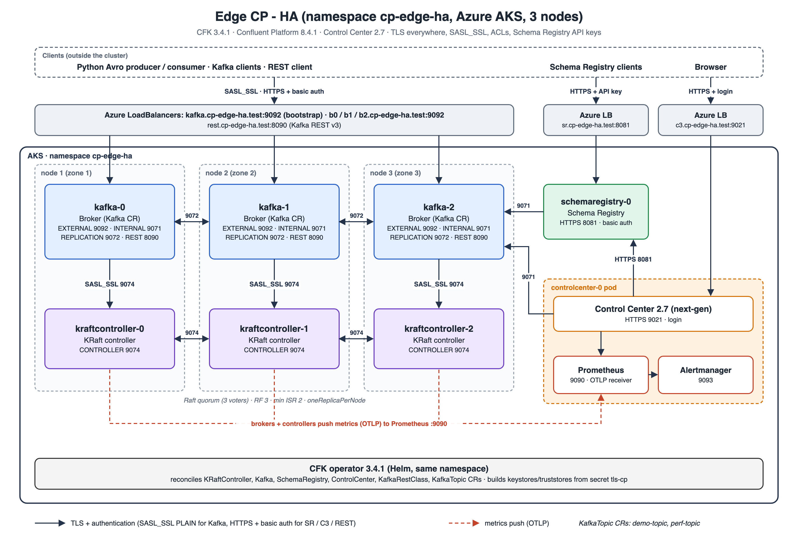
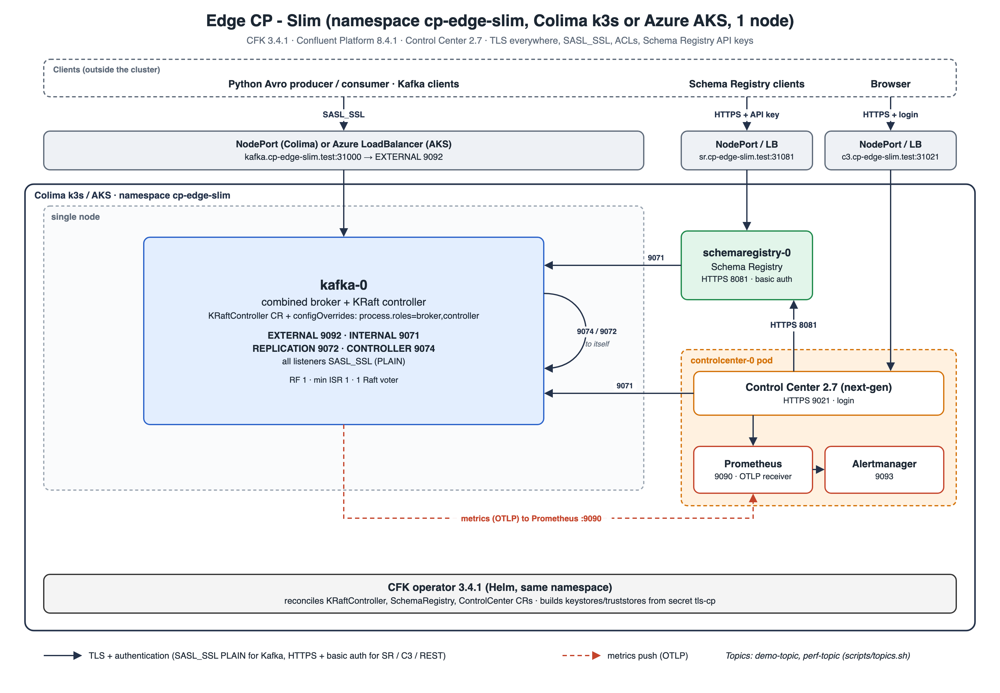

# Edge Confluent Platform - PoC

Confluent Platform **8.4** on Kubernetes, deployed with **Confluent for Kubernetes (CFK) 3.4**, in two flavours:

| Variant  | Namespace      | Components                                                                 | Runs on        |
|----------|----------------|----------------------------------------------------------------------------|----------------|
| **HA**   | `cp-edge-ha`   | 3x KRaft controllers, 3x brokers, 1x Schema Registry, 1x Control Center (+ Prometheus/Alertmanager) | Azure AKS (3 nodes) |
| **Slim** | `cp-edge-slim` | 1x combined broker/KRaft, 1x Schema Registry, 1x Control Center (+ Prometheus/Alertmanager)         | Colima (local) or Azure AKS (1 node) |

Both variants use TLS on every listener, SASL_SSL (PLAIN) for Kafka, Kafka ACLs, and API keys (HTTPS + basic auth) for Schema Registry. Certificates are self-signed.

## Contents

1. [Scope](#1-scope)
2. [Prerequisites](#2-prerequisites)
3. [Running on Colima (slim only)](#3-running-on-colima-slim-only)
4. [Running on Azure AKS (HA or slim)](#4-running-on-azure-aks-ha-or-slim)
5. [Using the demo](#5-using-the-demo)
6. [Credentials](#6-credentials)
7. [Tearing it down](#7-tearing-it-down)
8. [Troubleshooting](#8-troubleshooting)

## 1. Scope

### Architecture

Every arrow is TLS plus authentication: SASL_SSL (PLAIN) for Kafka traffic, HTTPS + basic auth for Schema Registry, Control Center and Kafka REST. The CFK operator, deployed in the same namespace, manages every component from its custom resource (CR).

#### HA (`cp-edge-ha`, AKS, 3 nodes)



#### Slim (`cp-edge-slim`, Colima or AKS, 1 node)



The diagrams are generated by `docs/diagrams.py` (SVG) and rendered to PNG with headless Chrome: `docs/render.sh`.

### Versions

| Component                       | Version / image                                                                 |
|---------------------------------|---------------------------------------------------------------------------------|
| CFK operator                    | 3.4.1 (Helm chart `confluentinc/confluent-for-kubernetes` `0.2038.24`)          |
| CFK init container              | `confluentinc/confluent-init-container:3.4.1`                                   |
| Kafka (Confluent Server), KRaft | `confluentinc/cp-server:8.4.1` (Apache Kafka 4.4)                                |
| Schema Registry                 | `confluentinc/cp-schema-registry:8.4.1`                                          |
| Control Center (next-gen)       | `confluentinc/cp-enterprise-control-center-next-gen:2.7.0`                       |
| Prometheus / Alertmanager (C3)  | `confluentinc/cp-enterprise-prometheus:2.7.0` / `cp-enterprise-alertmanager:2.7.0` |

All images are multi-arch (amd64/arm64), so the same manifests run on Apple Silicon (Colima) and AKS.
The CFK CRDs used are documented in the [CFK API reference](https://docs.confluent.io/operator/current/co-api.html) (`platform.confluent.io/v1beta1`): `KRaftController`, `Kafka`, `SchemaRegistry`, `ControlCenter`, `KafkaRestClass` and `KafkaTopic`.

### Security

Every listener is encrypted and authenticated. There is no plaintext anywhere.

| Path                                   | Protocol                  | Credentials                                       |
|----------------------------------------|---------------------------|---------------------------------------------------|
| External clients -> Kafka (EXTERNAL)   | SASL_SSL (PLAIN)          | `config/credentials/kafka-users.json`             |
| SR / C3 -> Kafka (INTERNAL, 9071)      | SASL_SSL (PLAIN)          | user `kafka`                                      |
| Broker <-> broker (REPLICATION, 9072)  | SASL_SSL (PLAIN)          | user `kafka`                                      |
| Broker <-> KRaft (CONTROLLER, 9074)    | SASL_SSL (PLAIN)          | user `kafka`                                      |
| Schema Registry REST                   | HTTPS + basic auth ("API key/secret") | `config/credentials/sr-users.txt`     |
| Control Center UI                      | HTTPS + basic auth login  | `config/credentials/c3-users.txt`                 |
| Kafka REST / Admin API v3 (HA only)    | HTTPS + basic auth        | `config/credentials/rest-users.txt`               |

- **TLS**: self-signed. `scripts/certs.sh` creates one CA (shared by both variants) plus one server certificate per variant. The certificate covers the external hostnames (`*.cp-edge-<variant>.test`) and the in-cluster service/pod names. CFK builds the keystores and truststores from it (secret `tls-cp`). Updating the secret triggers a rolling restart, so certificates can be rotated by re-running `certs.sh`.
- **Authorization**: Kafka ACLs (`authorization.type: simple`, `allow.everyone.if.no.acl.found=false`), with super user `User:kafka`. A user without ACLs can authenticate but can't read or write anything. Confluent RBAC is not used.
- **Users**: Kafka PLAIN users are hot-reloaded (`refresh_ms=3000`). Edit `config/credentials/kafka-users.json` and re-run `scripts/secrets.sh <variant>`. No restart is needed.
- **Metrics**: brokers and KRaft push metrics (OTLP) to the Prometheus bundled with Control Center (`dependencies.metricsClient`). There is no JMX exporter or Grafana stack to run.

> **Slim / combined mode:** CFK has no first-class broker+controller combined mode. The slim variant is a single `KRaftController` CR (named `kafka`) whose generated config is extended through `configOverrides` with `process.roles=broker,controller` and the REPLICATION/INTERNAL/EXTERNAL listeners (see `k8s/slim/base/kafka.yaml`). It works well for edge/demo use, but Confluent doesn't support it for production. Use the HA layout there.

### Demo topics

| Topic        | Used by                                                                 | Format |
|--------------|-------------------------------------------------------------------------|--------|
| `demo-topic` | Python producer/consumer and the Avro console tools (`kafka-avro-console-*`). Schema Registry subject `demo-topic-value`, record `edge.cp.Customer` | Avro   |
| `perf-topic` | `kafka-producer-perf-test` and the plain console producer/consumer       | Raw bytes / text |

Keep raw (non-Avro) data out of `demo-topic`: the Avro consumers fail on records that weren't written through Schema Registry (`Unknown magic byte!`).

### Repository layout

```
config/
  credentials/        users and passwords (Kafka, Schema Registry API keys, C3 login, REST)
  tls/server.cnf      OpenSSL template for the server certificate (SANs)
  client/             client.properties for a local Kafka CLI (optional, needs Java)
k8s/
  ha/                 HA manifests (AKS, LoadBalancer) + KafkaTopic CRs
  slim/base/          slim manifests (no external access)
  slim/colima/        overlay: NodePorts on the Colima/k3s node
  slim/aks/           overlay: Azure LoadBalancers
scripts/
  env.sh              per-variant settings (namespace, hostnames, ports), sourced by the other scripts
  deploy.sh           end-to-end deploy: CFK + certs + secrets + CP
  teardown.sh         remove a variant (namespace, PVCs, operator, certs)
  certs.sh            self-signed CA + server cert + secret tls-cp
  secrets.sh          credential secrets from config/credentials/
  etc_hosts.sh        /etc/hosts entries + external endpoints
  kafka-cli.sh        run any Kafka CLI tool (incl. Avro console tools) inside the cluster
  topics.sh           demo-topic + perf-topic
  acls.sh             demo ACLs for demo-user-001
  python/             Avro producer/consumer using Schema Registry
terraform/main.tf     AKS cluster sized per variant
docs/                 architecture diagrams (PNG/SVG + generator)
certs/                generated certificates (git-ignored)
```

## 2. Prerequisites

```bash
brew install kubectl helm openssl gettext python3   # gettext provides envsubst
```

There's no Docker or Java requirement. The Kafka CLI runs inside the cluster (`scripts/kafka-cli.sh`), and the client truststore is generated with OpenSSL.

- **Colima**: `brew install colima`
- **AKS**: `brew install azure-cli terraform`

**Licence**: without a licence key, Confluent Platform runs in a 30-day trial mode. To apply a key, add `--set licenseKey=<key>` to the `helm upgrade` in `scripts/deploy.sh`, and uncomment `license.globalLicense: true` in the CRs.

## 3. Running on Colima (slim only)

Colima runs a single-node k3s cluster, so only the **slim** variant is supported locally. The HA variant needs one node per broker/controller (`oneReplicaPerNode`) and one LoadBalancer IP per broker.

### 3.1 Start a Kubernetes VM

A dedicated profile (`cfk`) keeps it separate from any other Colima/Docker VM. `--network-address` gives the VM an IP that is reachable from the Mac, which the NodePorts are exposed on.

```bash
colima start -p cfk --kubernetes --runtime containerd \
  --cpu 4 --memory 8 --disk 40 --network-address

kubectl config use-context colima-cfk
kubectl get nodes -o wide        # note the INTERNAL-IP, e.g. 192.168.64.2
```

The slim variant uses about 3 GiB of RAM and requests 1.25 vCPU / 5 GiB. 4 vCPU / 8 GiB leaves enough headroom. To resize later: `colima stop -p cfk && colima start -p cfk --cpu <n> --memory <GiB>`.

### 3.2 Deploy

```bash
./scripts/deploy.sh slim colima
```

This installs CFK into `cp-edge-slim`, generates the certificates, creates the secrets, applies `k8s/slim/colima` and waits until everything is `RUNNING` (about 3-5 minutes on the first run, which includes image pulls).

```bash
kubectl -n cp-edge-slim get pods
NAME                                  READY   STATUS    RESTARTS   AGE
confluent-operator-5f8cfd8b9b-p7g6d   1/1     Running   0          8m
controlcenter-0                       3/3     Running   0          7m
kafka-0                               1/1     Running   0          7m
schemaregistry-0                      1/1     Running   0          7m
```

### 3.3 Hostnames

`deploy.sh` ends by printing the `/etc/hosts` entry (run `./scripts/etc_hosts.sh slim colima` to print it again):

```bash
echo "192.168.64.2 kafka.cp-edge-slim.test sr.cp-edge-slim.test c3.cp-edge-slim.test" | sudo tee -a /etc/hosts
```

| Endpoint                   | URL                                    |
|----------------------------|----------------------------------------|
| Kafka bootstrap (SASL_SSL) | `kafka.cp-edge-slim.test:31000`        |
| Schema Registry (HTTPS)    | `https://sr.cp-edge-slim.test:31081`   |
| Control Center (HTTPS)     | `https://c3.cp-edge-slim.test:31021`   |

Then continue with [5. Using the demo](#5-using-the-demo) (use `slim` as the variant).

## 4. Running on Azure AKS (HA or slim)

### 4.1 Cluster sizing

| Variant | Nodes | Node size (default)                 | CP resource requests | Why                                                   |
|---------|-------|-------------------------------------|----------------------|-------------------------------------------------------|
| HA      | 3     | `Standard_D4s_v5` (4 vCPU / 16 GiB) | about 3.5 vCPU / 12 GiB | `oneReplicaPerNode`: each node runs 1 KRaft + 1 broker, and SR/C3 are spread across nodes |
| Slim    | 1     | `Standard_D4s_v5` (4 vCPU / 16 GiB) | about 1.25 vCPU / 5 GiB  | single combined node + SR + C3                     |

These sizes are for a functional demo. For performance tests, use `Standard_D8s_v5` (`-var vm_size=...`) and raise `podTemplate.resources` and `dataVolumeCapacity` in the CRs. Since CFK 3.4, the broker heap defaults to 50% of the memory request and the KRaft heap to 80%.

### 4.2 Create the cluster

With Terraform (`terraform/main.tf`):

```bash
az login
cd terraform
terraform init
terraform apply -var="subscription_id=$(az account show --query id -o tsv)" \
                -var="variant=ha" \
                -var="owner_email=<your email>"
$(terraform output -raw get_credentials)     # az aks get-credentials ...
cd ..
```

Or with the Azure CLI:

```bash
az group create --name edge-cp-poc --location uksouth --tags owner_email=<your email>
az aks create -g edge-cp-poc -n edge-cp --node-vm-size Standard_D4s_v5 \
  --node-count 3 --zones 1 2 3 --generate-ssh-keys --tags owner_email=<your email>   # --node-count 1 (no --zones) for slim
az aks get-credentials -g edge-cp-poc -n edge-cp
```

The Kubernetes version must be within the range CFK 3.4 supports (1.29 - 1.37). Check with `az aks get-versions -l uksouth`.

### 4.3 Deploy

```bash
./scripts/deploy.sh ha            # HA  -> k8s/ha
./scripts/deploy.sh slim aks      # or slim -> k8s/slim/aks
```

On HA, CFK also creates `demo-topic` and `perf-topic` from `k8s/ha/topics.yaml` (`KafkaTopic` CRs, through the embedded REST API):

```bash
kubectl -n cp-edge-ha get kafkatopic
NAME         REPLICAS   PARTITION   STATUS    CLUSTERID
demo-topic   3          3           CREATED   MTM5YTEwZGMtMDIxYi00Yw
perf-topic   3          3           CREATED   MTM5YTEwZGMtMDIxYi00Yw
```

### 4.4 Hostnames

Each external endpoint gets its own Azure LoadBalancer IP. Once the IPs are assigned (`kubectl -n cp-edge-ha get svc`), print the `/etc/hosts` entries (or create the records in a DNS zone you own):

```bash
./scripts/etc_hosts.sh ha
# Add to /etc/hosts (sudo vi /etc/hosts):
20.0.0.11 kafka.cp-edge-ha.test
20.0.0.12 b0.cp-edge-ha.test
20.0.0.13 b1.cp-edge-ha.test
20.0.0.14 b2.cp-edge-ha.test
20.0.0.15 rest.cp-edge-ha.test
20.0.0.16 sr.cp-edge-ha.test
20.0.0.17 c3.cp-edge-ha.test
```

| Endpoint                   | HA (AKS)                                 | Slim (AKS)                             |
|----------------------------|------------------------------------------|----------------------------------------|
| Kafka bootstrap (SASL_SSL) | `kafka.cp-edge-ha.test:9092` (brokers `b0..b2.cp-edge-ha.test:9092`) | `kafka.cp-edge-slim.test:31000` |
| Schema Registry (HTTPS)    | `https://sr.cp-edge-ha.test:8081`        | `https://sr.cp-edge-slim.test:31081`   |
| Control Center (HTTPS)     | `https://c3.cp-edge-ha.test:9021`        | `https://c3.cp-edge-slim.test:31021`   |
| Kafka REST v3 (HTTPS)      | `https://rest.cp-edge-ha.test:8090`      | n/a                                    |

> The LoadBalancers are public by default. To keep them internal to the VNet, add the annotation `service.beta.kubernetes.io/azure-load-balancer-internal: "true"` (`externalAccess.loadBalancer.annotations` in the CRs, `metadata.annotations` on `kafka-external`). You can also restrict sources with `loadBalancerSourceRanges`.

## 5. Using the demo

The examples use the slim variant on Colima. For HA, replace `slim` with `ha` and use the HA hostnames and ports from 4.4. Run everything from the repository root.

```bash
export VARIANT=slim
export DOMAIN=cp-edge-$VARIANT.test
export BOOTSTRAP=kafka.$DOMAIN:31000      # HA: kafka.cp-edge-ha.test:9092
export SR_URL=https://sr.$DOMAIN:31081    # HA: https://sr.cp-edge-ha.test:8081
export C3_URL=https://c3.$DOMAIN:31021    # HA: https://c3.cp-edge-ha.test:9021
```

(`source scripts/env.sh slim colima` sets the same variables, plus `NAMESPACE`.)

### 5.1 TLS check

```bash
openssl s_client -connect $BOOTSTRAP -servername kafka.$DOMAIN -CAfile certs/ca.pem </dev/null 2>/dev/null | grep 'Verify return'
# Verify return code: 0 (ok)
```

### 5.2 Topics and ACLs

```bash
./scripts/topics.sh $VARIANT     # creates demo-topic and perf-topic (RF 3 / min ISR 2 on HA, RF 1 on slim)
./scripts/acls.sh $VARIANT       # demo-user-001: All on demo-topic, All on group demo-consumer-group, Describe on the cluster
./scripts/kafka-cli.sh $VARIANT kafka-acls --list
```

Both scripts are idempotent. On HA the topics already exist from the `KafkaTopic` CRs.

### 5.3 Kafka CLI (`scripts/kafka-cli.sh`)

There's no need for a local Kafka install or to `exec` into a pod yourself. `scripts/kafka-cli.sh <variant> <tool> [args]` runs the tool inside the cluster as the `kafka` super user over the internal SASL_SSL listener, and adds `--bootstrap-server` and the client config (`--command-config`, `--producer.config` or `--consumer.config`) for you.

- Plain tools run in the broker pod (`kafka-0`).
- The Avro console tools only ship in the Schema Registry image, so they run in `schemaregistry-0`. The script adds the Schema Registry URL (HTTPS), truststore and API key (`config/credentials/sr-client.txt`).

The `kafka` super user bypasses ACLs, so this is for administration and inspecting data. Use the Python clients (5.5) to see what an ACL-restricted user can do.

Admin:

```bash
./scripts/kafka-cli.sh $VARIANT kafka-topics --list
./scripts/kafka-cli.sh $VARIANT kafka-topics --describe --topic demo-topic
./scripts/kafka-cli.sh $VARIANT kafka-get-offsets --topic demo-topic
./scripts/kafka-cli.sh $VARIANT kafka-consumer-groups --describe --group demo-consumer-group
./scripts/kafka-cli.sh $VARIANT kafka-acls --add --allow-principal User:guest-001 --operation Read --topic demo-topic
```

Performance test and plain console tools (`perf-topic`):

```bash
./scripts/kafka-cli.sh $VARIANT kafka-producer-perf-test --topic perf-topic --num-records 20000 --record-size 1000 \
  --throughput -1 --producer-props acks=all compression.type=lz4
# 20000 records sent, 41580.0 records/sec (39.65 MB/sec), 104.63 ms avg latency, ...

./scripts/kafka-cli.sh $VARIANT kafka-console-producer --topic perf-topic        # type lines, Ctrl-D to finish
./scripts/kafka-cli.sh $VARIANT kafka-console-consumer --topic perf-topic --from-beginning --max-messages 10
```

Avro console tools (`demo-topic`, same `Customer` schema as the Python clients):

```bash
SCHEMA='{"type":"record","name":"Customer","namespace":"edge.cp","fields":[
  {"name":"name","type":"string"},{"name":"address","type":"string"},{"name":"ip","type":"string"}]}'

echo '{"name":"Jane Doe","address":"1 Main St","ip":"10.0.0.1"}' | \
  ./scripts/kafka-cli.sh $VARIANT kafka-avro-console-producer --topic demo-topic --reader-property value.schema="$SCHEMA"

./scripts/kafka-cli.sh $VARIANT kafka-avro-console-consumer --topic demo-topic --from-beginning
# {"name":"Jane Doe","address":"1 Main St","ip":"10.0.0.1"}
```

Without `echo ... |`, the producer reads one JSON record per line from the terminal until Ctrl-D. Press Ctrl-C to stop a consumer, or add `--max-messages N`. A schema that isn't compatible with the latest version of `demo-topic-value` is rejected by Schema Registry (default compatibility `BACKWARD`).

Optionally, with Java 17+ and the Kafka CLI installed locally (`brew install openjdk kafka`), you can also connect from the Mac through the external listener using `config/client/client.properties`, which points at the generated `certs/truststore.p12`:

```bash
kafka-topics --bootstrap-server $BOOTSTRAP --command-config config/client/client.properties --list
```

### 5.4 Schema Registry (API key)

```bash
curl -s --cacert certs/ca.pem $SR_URL/subjects                                          # 401
curl -s --cacert certs/ca.pem -u demo-user-001:bad $SR_URL/subjects                      # 401
curl -s --cacert certs/ca.pem -u demo-user-001:demo-user-001-sr-secret $SR_URL/subjects   # ["demo-topic-value"] once data was produced
curl -s --cacert certs/ca.pem -u demo-user-001:demo-user-001-sr-secret $SR_URL/subjects/demo-topic-value/versions/latest
```

### 5.5 Python producer / consumer (Avro + Schema Registry)

The producer connects from the Mac through the external SASL_SSL listener as `demo-user-001`, registers the `edge.cp.Customer` Avro schema with `demo-user-001`'s SR API key, and produces fake customer records (Faker) to `demo-topic`. The consumer (group `demo-consumer-group`) reads them back and deserialises them through Schema Registry. Hostname verification stays on. Run `acls.sh` first (5.2).

```bash
python3 -m venv .venv && .venv/bin/pip install -r scripts/python/requirements.txt
VARIANT=$VARIANT .venv/bin/python scripts/python/producer.py     # Ctrl-C to stop
VARIANT=$VARIANT .venv/bin/python scripts/python/consumer.py     # Ctrl-C to stop
```

Every setting can be overridden with an environment variable (`BOOTSTRAP`, `KAFKA_USER`, `KAFKA_PASSWORD`, `SR_URL`, `SR_API_KEY`, `TOPIC`, `GROUP_ID`, `CA_FILE`). See `scripts/python/common.py`. Negative tests:

| Override                                               | Result                                 |
|--------------------------------------------------------|----------------------------------------|
| `KAFKA_USER=guest-001 KAFKA_PASSWORD=guest-001-secret` | `TOPIC_AUTHORIZATION_FAILED` (no ACLs) |
| `KAFKA_PASSWORD=wrong`                                 | `SASL authentication error`            |
| `SR_API_KEY=demo-user-001:wrong`                       | `SchemaRegistryError` (401)            |

### 5.6 Control Center

Open `$C3_URL` (for example https://c3.cp-edge-slim.test:31021) and log in with `admin` / `admin-secret`. Your browser will warn about the self-signed CA unless you trust `certs/ca.pem` (macOS: `sudo security add-trusted-cert -d -r trustRoot -k /Library/Keychains/System.keychain certs/ca.pem`).

### 5.7 Kafka REST / Admin API v3 (HA)

```bash
curl -s --cacert certs/ca.pem -u kafka:kafka-secret https://rest.cp-edge-ha.test:8090/kafka/v3/clusters | jq .
```

## 6. Credentials

All are demo values. Change them in `config/credentials/` and re-run `./scripts/secrets.sh <variant>`.

| File                  | Format                    | Used for                                                   |
|-----------------------|---------------------------|------------------------------------------------------------|
| `kafka-users.json`    | `{"user": "password"}`    | Kafka SASL/PLAIN user store (all listeners, hot-reloaded)  |
| `kafka-client.txt`    | `username=` / `password=` | Credentials of `kafka` (inter-broker, KRaft, SR/C3 -> Kafka) |
| `sr-users.txt`        | `user: secret,role`       | Schema Registry API keys (roles `admin`, `developer`)      |
| `sr-client.txt`       | `username=` / `password=` | C3 and the Avro console tools -> Schema Registry           |
| `c3-users.txt`        | `user: password,role`     | Control Center login                                       |
| `rest-users.txt`      | `user: password,role`     | Kafka REST API (HA)                                        |
| `rest-client.txt`     | `username=` / `password=` | CFK -> Kafka REST (`KafkaRestClass`, `KafkaTopic` CRs)     |

Demo users:

| User                                   | Kafka password         | SR API key                | Notes                                           |
|----------------------------------------|------------------------|---------------------------|-------------------------------------------------|
| `kafka`                                | `kafka-secret`         | -                         | Super user (internal, CLI, REST)                |
| `demo-user-001`                        | `demo-user-001-secret` | `demo-user-001-sr-secret` | ACLs from `acls.sh`; used by the Python clients |
| `guest-001`                            | `guest-001-secret`     | `guest-001-sr-secret`     | No ACLs (negative tests)                        |
| `demo-user-002..005`, `guest-002..005` | `<user>-secret`        | -                         | Spare Kafka users                               |
| `sr-admin`                             | -                      | `sr-admin-secret`         | Schema Registry admin                           |
| `admin` (C3)                           | -                      | -                         | Control Center login, `admin-secret`            |

## 7. Tearing it down

```bash
./scripts/teardown.sh slim colima     # or: ./scripts/teardown.sh ha | ./scripts/teardown.sh slim aks
colima stop -p cfk                    # or colima delete -p cfk
```

On AKS, delete the cluster with `terraform destroy -var=...` (or `az group delete -n edge-cp-poc`).
`rm -rf certs` removes the generated CA, so the next `deploy.sh` creates a new one.

## 8. Troubleshooting

| Symptom                                                    | Fix                                                                 |
|------------------------------------------------------------|---------------------------------------------------------------------|
| `kafka-topics: command not found`                          | Use `./scripts/kafka-cli.sh <variant> kafka-topics ...` (no local Java needed) |
| Python/openssl can't resolve `kafka.cp-edge-<variant>.test` | Add the `/etc/hosts` entries (`./scripts/etc_hosts.sh <variant> [platform]`) |
| `Unknown magic byte!` in an Avro consumer                  | The topic has non-Avro records. Keep plain/perf data in `perf-topic` |
| Avro producer: `Schema being registered is incompatible`   | Use the same schema as `demo-topic-value` (5.3), or a compatible evolution |
| `TOPIC_AUTHORIZATION_FAILED` / `GROUP_AUTHORIZATION_FAILED` | Run `./scripts/acls.sh <variant>`, or add ACLs for that user          |
| Pods `Pending` on HA                                       | HA needs 3 nodes (`oneReplicaPerNode`). Check `kubectl describe pod`  |
| Browser certificate warning                                | Trust `certs/ca.pem` (5.6)                                           |
